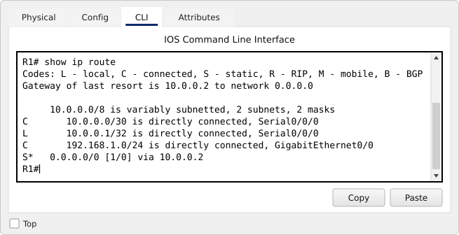
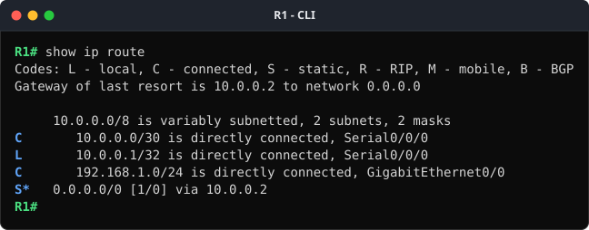
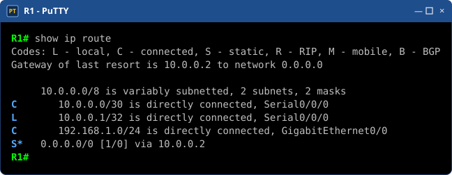
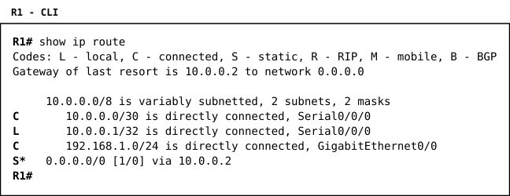
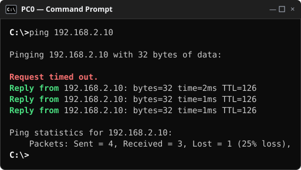

# stu-packet-tracer-mcp

A student-focused **Model Context Protocol (MCP)** server for **Cisco Packet Tracer 9**. Connect Claude, Antigravity, Cursor, VS Code, or Gemini CLI directly to your open Packet Tracer workspace to build topologies, run Cisco IOS commands without `--More--` truncation, generate crisp terminal-style CLI screenshots (SVG & PNG), verify lab objectives, and export submission-ready **DOCX, print-to-PDF HTML, and Markdown** lab reports in one command.

> [!NOTE]
> *Demo preview placeholder:* drop a short GIF of `pt_capture_cli` + `pt_export_report` here once recorded, or see the rendered terminal snapshots in [docs/REPORTS.md](docs/REPORTS.md).

---

## Highlights

- **Terminal-style CLI & PC Command Prompt screenshots** (`pt_capture_cli`, `pt_capture_pc_command`, `pt_render_terminal`) — crisp vector SVG + 2x PNG rasterization via embedded `@resvg/resvg-wasm` and bundled **DejaVu Sans Mono** fonts (no Chrome or system font dependencies).
  - 5 built-in themes: `pt-classic` (Packet Tracer CLI tab chrome), `dark`, `putty`, `high-contrast` (print-ready), and `pc-cmd` (Windows Command Prompt).
- **One-command lab report export** (`pt_export_report`) — collects the live topology screenshot, addressing table, ping matrix, IOS CLI captures, PC command outputs, and Before/After fault-fix sections into **Microsoft Word (`.docx`)**, self-contained **print-ready HTML**, and **Markdown**.
- **Student workflow & troubleshooting tools** — `pt_addressing_table`, `pt_ping_matrix` (with automatic ARP warm-up so first pings do not false-fail), `pt_check_lab` objective verifier, `pt_diagnose_faults` (study hints / fix commands / live auto-fix for common lab mistakes), `pt_trace_path` (bidirectional forward & return hop analyzer), `pt_break_lab` (exam practice fault injector), `pt_explain_output` (offline IOS output explainer), `pt_subnet_calc` (IPv4 + VLSM planner), and `pt_lab_template` (10 university networking labs).
- **Resilient Cisco IOS CLI engine** — automatically clears `[yes/no]` initial configuration dialogs, handles `--More--` pagination cleanly, prevents eaten first characters, and tracks prompt modes (`user`, `privileged`, `config`, `config-if`, etc.).
- **Reliable Bridge Protocol v1** — correlation IDs per request, long-poll `/v1/next`, strict single-flight serialization, late-result dropping, origin validation, optional shared token (`STU_PT_BRIDGE_TOKEN`), and automatic extension reconnect.
- **Teach Mode (`STU_PT_TEACH_MODE=1` / `dry_run: true`)** — off by default; turn it on to study step-by-step IOS commands and explanations without modifying the canvas.
- **100% English & strict schemas** — all 70 tools enforce strict input validation and provide "Did you mean ...?" device suggestions on typos.

---

## 5-Minute Quick Start

### 1. Install Bun

```bash
# Linux / macOS
curl -fsSL https://bun.sh/install | bash
```

```powershell
# Windows (PowerShell)
powershell -c "irm bun.sh/install.ps1 | iex"
```

### 2. Add the MCP server to your AI client (stdio recommended)

Example for **Claude Desktop** or **Cursor** (see [docs/CLIENTS.md](docs/CLIENTS.md) for Antigravity, VS Code, Gemini CLI, and HTTP mode):

```json
{
  "mcpServers": {
    "stu-packet-tracer": {
      "command": "bunx",
      "args": ["stu-packet-tracer-mcp", "--stdio"]
    }
  }
}
```

### 3. Connect Cisco Packet Tracer 9

1. Open Cisco Packet Tracer 9 and load your `.pkt` lab file.
2. Load the **Student MCP Bridge** Script Module (`extension/dist/stu-mcp-bridge.pts` — see [docs/BUILD_EXTENSION.md](docs/BUILD_EXTENSION.md) to package it from `extension/src/`, or use the quick paste fallback in [docs/TROUBLESHOOTING.md](docs/TROUBLESHOOTING.md)).
3. Open **Extensions -> Scripting -> Student MCP Bridge** and verify the status dot turns green (`Connected · Bridge v1`).

### 4. Verify the connection

Ask your AI assistant:

> "Check `pt_bridge_status` and list the devices in my current Packet Tracer lab."

For full step-by-step setup instructions, read [docs/QUICKSTART.md](docs/QUICKSTART.md).

---

## Your First Lab Report

Once Packet Tracer is connected with your lab open, try a prompt like:

> "Verify connectivity between PC-A, PC-B, PC-C, and PC-D using `pt_ping_matrix`, then export a DOCX and HTML lab report titled 'Static Routing Workshop' with the addressing table, `show ip route` from R1 and R2, and `ping` output from PC-A to PC-D."

The server saves every capture and report under `./stu-pt-output/` (configurable with `STU_PT_OUTPUT_DIR`):

```text
stu-pt-output/
  static-routing-workshop/
    report.docx          # Microsoft Word with embedded 2x PNG screenshots & shaded tables
    report.html          # Single self-contained file — open in browser and Print -> Save as PDF
    report.md            # Markdown referencing relative captures/
    captures/
      topology.png
      ping-matrix.svg / .png
      r1-show-ip-route.svg / .png
      pc-a-ping.svg / .png
```

---

## Terminal Themes Preview

| Theme | Preview | Best For |
|---|---|---|
| `pt-classic` |  | Authentic Cisco Packet Tracer CLI tab look |
| `dark` |  | Modern dark slides, web docs, dark-mode notes |
| `putty` |  | Classic SSH / PuTTY console captures |
| `high-contrast` |  | Printed university reports & black-and-white PDFs |
| `pc-cmd` |  | Packet Tracer PC / Server Command Prompt outputs |

See [docs/REPORTS.md](docs/REPORTS.md) for full theming, callout annotations, and `pt_export_report` examples.

---

## Teach Mode & Academic Integrity

`stu-packet-tracer-mcp` is built to help networking students **understand, verify, and document** their labs faster — not to skip learning Cisco IOS.

- **Teach Mode is OFF by default**, so you can inspect and automate labs freely when needed.
- Set `STU_PT_TEACH_MODE=1` in your MCP client environment (or pass `dry_run: true` to configuration/template tools) to switch into **study mode**: instead of applying changes to Packet Tracer, tools return the exact IOS commands, mode transitions, and step-by-step explanations so you can type and practice them yourself.
- Use `pt_explain_output` and `pt_check_lab` to diagnose routing tables, ARP caches, VLANs, and subnet masks while studying for coursework or CCNA exams.
- Always follow your instructor's and institution's academic integrity guidelines when using AI tools on graded assignments.

---

## Documentation

- [Quick Start Guide](docs/QUICKSTART.md) — Bun setup, extension loading, and first verification
- [MCP Client Configurations](docs/CLIENTS.md) — Claude Desktop, Antigravity, Cursor, VS Code, Gemini CLI
- [Terminal Screenshots & Lab Reports](docs/REPORTS.md) — themes gallery and `pt_export_report` guide
- [Complete Tool Reference (70 tools)](docs/TOOLS.md) — auto-generated from the live tool registry
- [Building the Packet Tracer Extension](docs/BUILD_EXTENSION.md) — package `extension/src/` into `.pts` inside PT 9
- [Architecture Overview](docs/ARCHITECTURE.md) — Bridge v1, CLI engine, renderer, and report pipeline
- [Troubleshooting](docs/TROUBLESHOOTING.md) — common Packet Tracer 9 & bridge fixes
- [Contributing](CONTRIBUTING.md) & [Changelog](CHANGELOG.md)

---

## Upstream Attribution & License

`stu-packet-tracer-mcp` is an independent hard fork of [`packet-tracer-mcp`](https://github.com/Jcorderop02/packet-tracer-mcp), originally created by **Juan Cordero Pascual** (`Jcorderop02`). See [NOTICE.md](NOTICE.md) for full attribution details.

Licensed under the [MIT License](LICENSE). Bundled DejaVu Sans Mono fonts are licensed under the Bitstream Vera / DejaVu license ([assets/fonts/LICENSE](assets/fonts/LICENSE)).
