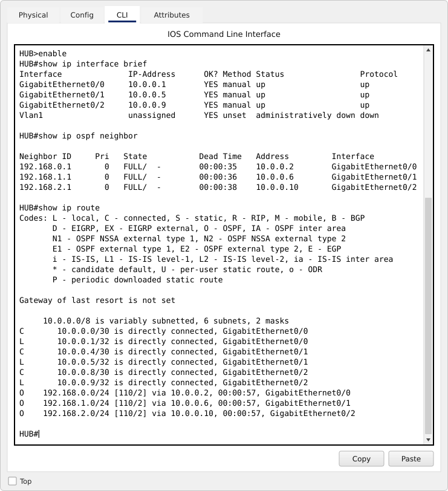
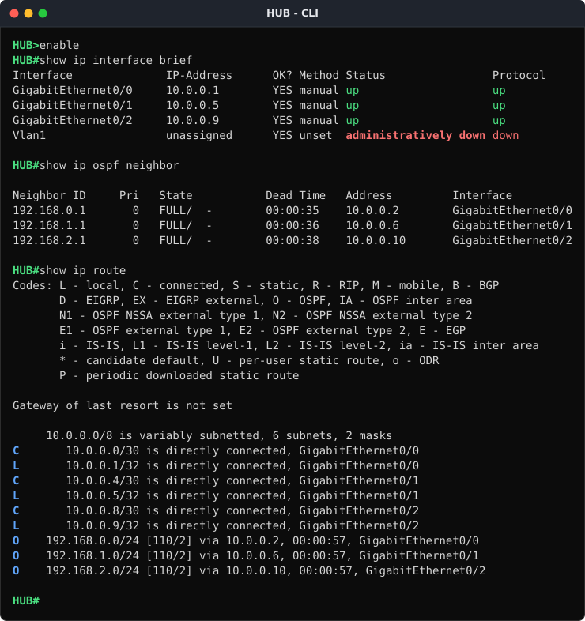
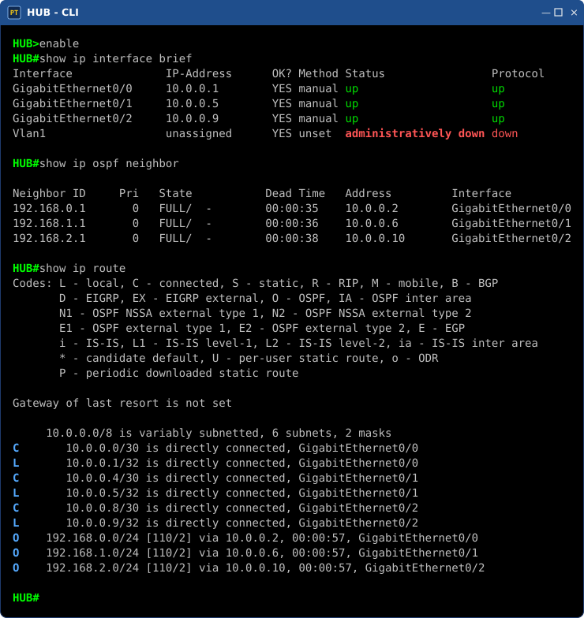
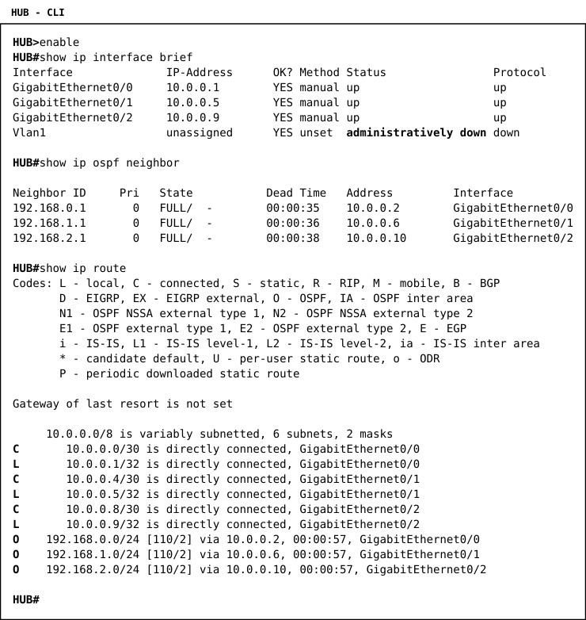
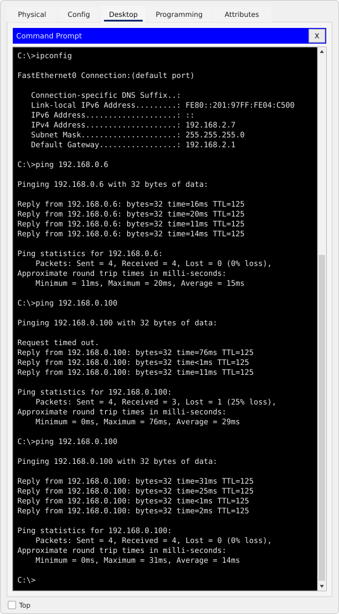

# stu-packet-tracer-mcp

[](https://github.com/fuih/stu-packet-tracer-mcp/actions/workflows/ci.yml)
[](LICENSE)
[](https://bun.sh)
[](docs/QUICKSTART.md)
[](docs/TOOLS.md)

A student-focused **Model Context Protocol (MCP)** server for **Cisco Packet Tracer 9**. Connect Claude, Antigravity, Cursor, VS Code, or Gemini CLI directly to your open Packet Tracer workspace to build topologies in a single turn, run Cisco IOS commands without `--More--` truncation, generate crisp terminal-style CLI screenshots (SVG & PNG), verify lab objectives, and export submission-ready **DOCX, print-to-PDF HTML, and Markdown** lab reports in one command.

---

## Highlights

- **Terminal-style CLI & PC Command Prompt screenshots** (`pt_capture_cli`, `pt_capture_pc_command`, `pt_render_terminal`) — crisp vector SVG + 2x PNG rasterization via embedded `@resvg/resvg-wasm` and bundled **DejaVu Sans Mono** fonts (no Chrome or system font dependencies).
  - 5 built-in themes: `pt-classic` (Packet Tracer CLI tab chrome), `dark`, `putty`, `high-contrast` (print-ready), and `pc-cmd` (Windows Command Prompt).
- **One-command lab report export** (`pt_export_report`) — collects the live topology screenshot, addressing table, ping matrix, IOS CLI captures, PC command outputs, and Before/After fault-fix sections into **Microsoft Word (`.docx`)**, self-contained **print-ready HTML**, and **Markdown**.
- **Student workflow & troubleshooting tools** — `pt_addressing_table`, `pt_ping_matrix` (with automatic ARP warm-up so first pings do not false-fail), `pt_check_lab` objective verifier, `pt_diagnose_faults` (study hints / fix commands / live auto-fix for common lab mistakes), `pt_trace_path` (bidirectional forward & return hop analyzer), `pt_break_lab` (exam practice fault injector), `pt_explain_output` (offline IOS output explainer), `pt_subnet_calc` (IPv4 + VLSM planner), and `pt_lab_template` (10 university networking labs).
- **Resilient Cisco IOS CLI engine** — automatically clears `[yes/no]` initial configuration dialogs, handles `--More--` pagination cleanly, prevents eaten first characters, and tracks prompt modes (`user`, `privileged`, `config`, `config-if`, etc.).
- **Reliable Bridge Protocol v1** — correlation IDs per request, long-poll `/v1/next`, strict single-flight serialization, late-result dropping, origin validation, optional shared token (`STU_PT_BRIDGE_TOKEN`), and automatic extension reconnect.
- **Teach Mode (`STU_PT_TEACH_MODE=1` / `dry_run: true`)** — off by default; turn it on to study step-by-step IOS commands and explanations without modifying the canvas.
- **100% English & strict schemas** — all 72 tools enforce strict input validation and provide "Did you mean ...?" device suggestions on typos.

---

## 5-Minute Quick Start

### 1. Install Bun

```bash
# Linux / macOS
curl -fsSL https://bun.sh/install | bash
```

```powershell
# Windows (PowerShell)
powershell -c "irm bun.sh/install.ps1 | iex"
```

### 2. Install and add the MCP server to your AI client

Clone the repository and install dependencies with Bun:

```bash
git clone https://github.com/fuih/stu-packet-tracer-mcp.git
cd stu-packet-tracer-mcp
bun install
```

Add this to your AI client configuration (example for **Claude Desktop**, **Antigravity**, or **Cursor** — see [docs/CLIENTS.md](docs/CLIENTS.md) for all clients and HTTP mode):

```json
{
  "mcpServers": {
    "stu-packet-tracer": {
      "command": "bun",
      "args": ["run", "/path/to/stu-packet-tracer-mcp/src/index.ts", "--stdio"]
    }
  }
}
```

*(If published via npm, replace `"command"`/`"args"` with `"command": "bunx"`, `"args": ["stu-packet-tracer-mcp", "--stdio"]`.)*

### 3. Connect Cisco Packet Tracer 9

1. Open Cisco Packet Tracer 9 and load your `.pkt` lab file (or start from a blank workspace).
2. Load the **Student MCP Bridge** Script Module (`extension/dist/stu-mcp-bridge.pts` — see [docs/BUILD_EXTENSION.md](docs/BUILD_EXTENSION.md) if packaging from `extension/src/`, or use the paste-in fallback in [docs/TROUBLESHOOTING.md](docs/TROUBLESHOOTING.md)).
3. Open **Extensions -> Scripting -> Student MCP Bridge**. The monitor header turns green (**Connected**) with the **`V1`** badge and automatically displays your active AI agent name (such as `Antigravity` or `Claude Desktop`) once your client connects.

### 4. Verify the connection

Ask your AI assistant:

> "Check `pt_bridge_status` and list the devices in my current Packet Tracer lab."

For full step-by-step setup instructions, read [docs/QUICKSTART.md](docs/QUICKSTART.md).

---

## User Guide: How to Use `stu-packet-tracer-mcp`

Once Packet Tracer shows **Connected (`V1`)**, ask your AI assistant in plain English. Below are the five main student workflows and real example prompts:

### 1. Build & Wire Topologies From Scratch or Diagrams
- Plan first (`pt_plan_review`), then build in one shot with **`pt_batch_build`** + **`pt_run_cli_batch`** (or step-by-step with `pt_add_device`, `pt_add_module`, `pt_create_link`, and `pt_auto_layout`).
- Or load a complete starter lab from 10 built-in university topologies using `pt_lab_template` (`static-routing`, `default-route`, `rip-v2`, `ospf-single-area`, `vlan-basic`, `inter-vlan-roas`, `dhcp`, `nat-pat`, `acl-standard`, `acl-extended`).
- **Try asking:** *"Build a 2-router OSPF single-area lab with 2 LAN switches and 2 PCs per LAN using `pt_lab_template`."*

### 2. Inspect, Verify, and Troubleshoot Broken Labs
- `pt_addressing_table`: extract a clean table of every router/switch interface and PC IP, subnet mask, and default gateway.
- `pt_ping_matrix`: test reachability between every host pair (including automatic ARP warm-up so first pings do not false-fail) and optionally render a color-coded grid image.
- `pt_diagnose_faults`: automatically detect common lab errors — powered-off nodes, `administratively down` ports, duplicate IPs, WAN `/30` subnet mismatches, classful `/8` mask traps, missing or wrong PC default gateways, self-pointing static routes, and one-way return routes. Supports `hints` (no spoilers), `commands`, and `autofix` modes.
- `pt_trace_path`: trace forward **and** return hops between two hosts to spot asymmetric return drops.
- `pt_break_lab`: inject `easy` / `medium` / `hard` faults into a healthy topology for hands-on troubleshooting practice.
- **Try asking:** *"Why can't PC1 ping PC2? Check with `pt_trace_path` and `pt_diagnose_faults` in `hints` mode first so I can try fixing it myself."*

### 3. Capture Authentic CLI & PC Command Prompt Screenshots
- `pt_capture_cli`: run IOS commands (`show ip route`, `show ip interface brief`, `show vlan brief`) and save crisp vector SVGs and 2x PNGs showing real Packet Tracer console scrollback history.
- `pt_capture_pc_command`: capture end-host Command Prompt commands (`ping`, `ipconfig`, `tracert`) rendered in authentic `pc-cmd` style.
- **Try asking:** *"Capture `show ip route` from R1 in `pt-classic` theme and `ping 192.168.20.10` from PC1."*

### 4. Export a Complete University Lab Report (DOCX / HTML / Markdown)
- `pt_export_report` gathers a live topology screenshot, addressing table, optional ping matrix, CLI/PC terminal captures, and Before/After troubleshooting fixes into `.docx`, self-contained print-to-PDF `.html`, and `.md` under `./stu-pt-output/` (override via `STU_PT_OUTPUT_DIR`).
- **Try asking:** *"Verify connectivity between PC1 and PC2 with `pt_ping_matrix`, then export a DOCX and HTML lab report titled 'Static Routing Workshop' with `show ip route` from R1 and `ipconfig` from PC1."*

### 5. Bridge Monitor Panel Controls
Inside Packet Tracer's **Student MCP Bridge** window:
- **Live lab telemetry & node inspector:** shows the active `.pkt` file, `REALTIME` / `SIM PLAYING` mode, router/switch/endpoint counts, link count with power/unwired alerts, IPC `ok`/`err` + `avg ms`, and a clickable **`LIVE LAB NODES`** strip (click any device chip or press **`refresh`** to log its power state, port count, and active IPs).
- **1-click lab toolbar & collapsible config:** **`wr all`** (`write memory` across all powered-on routers/switches), **`copy ips`** (copies a live Markdown addressing table to your clipboard), **`power on`** (appears automatically when any node is powered off), and **`config`** (collapses `--url` and `--token` out of the way to maximize stream height).
- **Filter stream logs:** click **`ALL`**, **`SYS`**, **`IPC`**, or **`ERR`**, and toggle **`autoscroll: ON / OFF`**.
- **Hotkeys:** `s` stop/start bridge polling · `r` refresh lab telemetry · `c` clear stream · `u` open config & focus `--url` · `l` focus logs · `/` or `:` focus `pt-bridge>` CLI prompt.
- **Built-in `pt-bridge>` prompt commands:** `:help`, `start`, `stop`, `clear`, `refresh`, `wr`, `ips`, `power`, `config`, `inspect <dev>`, `filter [all|sys|ipc|err]`, `ping`, `status`, `url <endpoint>`, `token <secret|clear>`.

---

## Quick Example Prompt

Once Packet Tracer is connected with your lab open, try a prompt like:

> "Verify connectivity between PC-A, PC-B, PC-C, and PC-D using `pt_ping_matrix`, then export a DOCX and HTML lab report titled 'Static Routing Workshop' with the addressing table, `show ip route` from R1 and R2, and `ping` output from PC-A to PC-D."

The server saves every capture and report under `./stu-pt-output/` (configurable with `STU_PT_OUTPUT_DIR`):

```text
stu-pt-output/
  static-routing-workshop/
    report.docx          # Microsoft Word with embedded 2x PNG screenshots & shaded tables
    report.html          # Single self-contained file — open in browser and Print -> Save as PDF
    report.md            # Markdown referencing relative captures/
    captures/
      topology.png
      ping-matrix.svg / .png
      r1-show-ip-route.svg / .png
      pc-a-ping.svg / .png
```

---

## Terminal Themes Preview

| Theme | Preview | Best For |
|---|---|---|
| `pt-classic` |  | Authentic Cisco Packet Tracer CLI tab look |
| `dark` |  | Modern dark slides, web docs, dark-mode notes |
| `putty` |  | Classic SSH / PuTTY console captures |
| `high-contrast` |  | Printed university reports & black-and-white PDFs |
| `pc-cmd` |  | Packet Tracer PC / Server Command Prompt outputs |

See [docs/REPORTS.md](docs/REPORTS.md) for full theming, callout annotations, and `pt_export_report` examples.

---

## Teach Mode & Academic Integrity

`stu-packet-tracer-mcp` is built to help networking students **understand, verify, and document** their labs faster — not to skip learning Cisco IOS.

- **Teach Mode is OFF by default**, so you can inspect and automate labs freely when needed.
- Set `STU_PT_TEACH_MODE=1` in your MCP client environment (or pass `dry_run: true` to configuration/template tools) to switch into **study mode**: instead of applying changes to Packet Tracer, tools return the exact IOS commands, mode transitions, and step-by-step explanations so you can type and practice them yourself.
- Use `pt_explain_output` and `pt_check_lab` to diagnose routing tables, ARP caches, VLANs, and subnet masks while studying for coursework or CCNA exams.
- Always follow your instructor's and institution's academic integrity guidelines when using AI tools on graded assignments.

---

## Documentation

- [Quick Start Guide](docs/QUICKSTART.md) — Bun setup, extension loading, and first verification
- [MCP Client Configurations](docs/CLIENTS.md) — Claude Desktop, Antigravity, Cursor, VS Code, Gemini CLI
- [Terminal Screenshots & Lab Reports](docs/REPORTS.md) — themes gallery and `pt_export_report` guide
- [Complete Tool Reference (72 tools)](docs/TOOLS.md) — auto-generated from the live tool registry
- [Building the Packet Tracer Extension](docs/BUILD_EXTENSION.md) — package `extension/src/` into `.pts` inside PT 9
- [Architecture Overview](docs/ARCHITECTURE.md) — Bridge v1, CLI engine, renderer, and report pipeline
- [Troubleshooting](docs/TROUBLESHOOTING.md) — common Packet Tracer 9 & bridge fixes
- [Contributing](CONTRIBUTING.md) & [Changelog](CHANGELOG.md)

---

## Upstream Attribution & License

`stu-packet-tracer-mcp` is an independent hard fork of [`packet-tracer-mcp`](https://github.com/Jcorderop02/packet-tracer-mcp), originally created by **Juan Cordero Pascual** (`Jcorderop02`). See [NOTICE.md](NOTICE.md) for full attribution details.

Licensed under the [MIT License](LICENSE). Bundled DejaVu Sans Mono fonts are licensed under the Bitstream Vera / DejaVu license ([assets/fonts/LICENSE](assets/fonts/LICENSE)).
