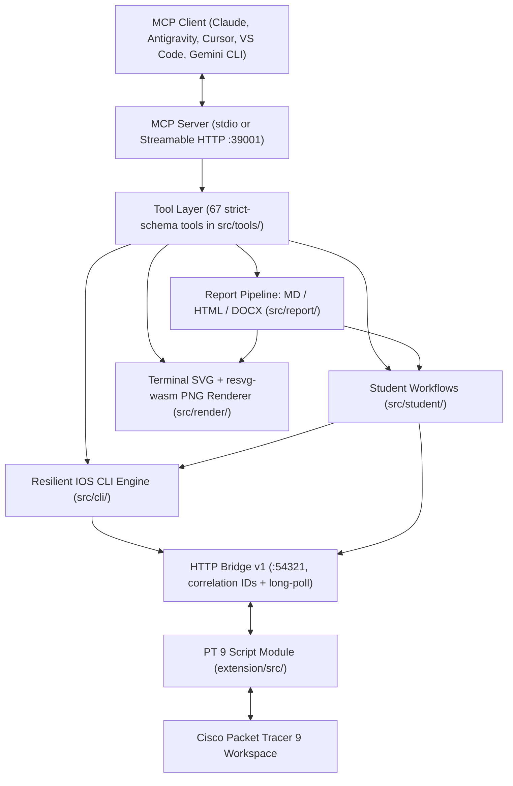

# Architecture

`stu-packet-tracer-mcp` uses a **canvas-first** architecture for Cisco Packet Tracer 9. There is no hidden shadow topology in memory — the open Packet Tracer workspace is always the single source of truth.

---

## System Overview

---

## Core Modules

### 1. Bridge Protocol v1 (`src/bridge/`)
- **Correlation IDs (`crypto.randomUUID()`)**: every JS evaluation request gets a unique ID tracked in a pending map.
- **Late-result drop**: if a command times out and its response arrives late, it is logged and discarded rather than leaking to the next caller.
- **Long-poll `GET /v1/next?wait=25000`**: wakes immediately when a tool submits work (sub-50ms dispatch latency) and returns `204` on idle timeout.
- **Strict single-flight serialization**: Packet Tracer's Qt Script Engine executes one command at a time; concurrent MCP tool calls queue cleanly.
- **Security**: binds only to `127.0.0.1`, validates browser `Origin` headers (rejecting foreign origins with HTTP 403), and supports an optional shared secret (`STU_PT_BRIDGE_TOKEN` / `X-Stu-Token`).
- **Legacy compatibility**: retains `/next`, `/result` (hex), `/ping`, and `/status` so existing `.pts` extensions still work.

### 2. Resilient Cisco IOS CLI Engine (`src/cli/`)
- `prompt.ts`: parses IOS prompts across modes (`user`, `privileged`, `config`, `config-if`, `config-subif`, `config-router`, `config-line`, `config-vlan`, `dhcp-config`, `rommon`, `dialog`).
- `clean.ts`: strips ANSI sequences, `--More--` pager strings, backspace wipes, command echoes, and extracts `%SYS-...` / `%LINK-...` syslog lines into a separate `logs[]` array.
- `engine.ts`: prepares each device once per session (dismisses `[yes/no]` dialog, runs `enable`, attempts `terminal length 0`), clears lingering `--More--` before dispatching so characters are never eaten, polls slices non-blocking, and advances mid-output pagination automatically.

### 3. Strict Tool Layer (`src/tools/`, `src/util/`)
- Every tool enforces `.strict()` Zod schemas (`additionalProperties: false`) via `defineTool` and `installStrictToolWrapper`.
- `src/util/devices.ts` provides exact, case-insensitive, and Levenshtein distance (`<= 2`) "Did you mean ...?" device suggestions.
- `src/util/errors.ts` standardizes actionable English error codes (`BRIDGE_NOT_CONNECTED`, `DEVICE_NOT_FOUND`, `CLI_TIMEOUT`, etc.).
- `scripts/gen-tools-doc.ts` generates `docs/TOOLS.md` directly from the live MCP tool registry and is enforced in CI (`bun run check:tools`).

### 4. Terminal Renderer (`src/render/`)
- Zero external browser dependencies: pure TypeScript SVG builder (`terminal-svg.ts`) with 5 themes (`themes.ts`), Cisco IOS & PC CMD syntax highlighting (`highlight.ts`), hard column wrapping, and right-margin callout annotations.
- Lazy `@resvg/resvg-wasm` rasterizer (`png.ts`) renders 2x crisp PNGs using bundled **DejaVu Sans Mono** TTF files (`assets/fonts/`) embedded via Bun `with { type: "file" }` imports so standalone binaries work anywhere.

### 5. Student Features & Report Export (`src/student/`, `src/report/`)
- Offline tools (`pt_subnet_calc`, `pt_explain_output`, `pt_render_terminal`) work with zero Packet Tracer dependency.
- Live student tools (`pt_addressing_table`, `pt_ping_matrix`, `pt_check_lab`, `pt_lab_template`) support optional Teach Mode (`STU_PT_TEACH_MODE=1` or `dry_run: true`).
- `pt_export_report` runs a clean `collect -> model -> render` pipeline producing Markdown, self-contained print-ready HTML, and native Microsoft Word `.docx` files.
