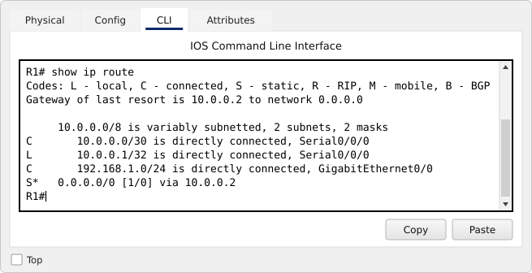
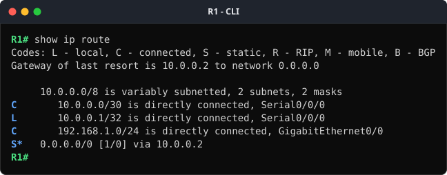
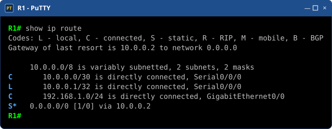
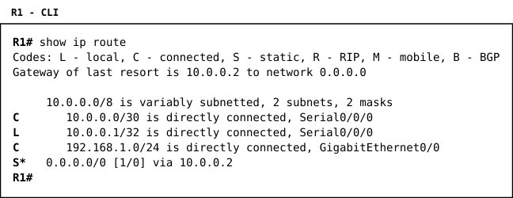
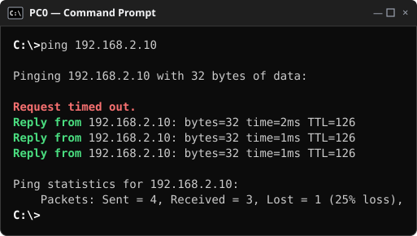

# Terminal Screenshots & Lab Reports

`stu-packet-tracer-mcp` turns live Cisco Packet Tracer CLI outputs and PC Command Prompt sessions into crisp, publication-grade vector SVGs, 2x PNGs, and complete university lab reports.

---

## Terminal Themes Gallery

Every terminal renderer (`pt_capture_cli`, `pt_capture_pc_command`, `pt_render_terminal`, and `pt_export_report`) uses bundled **DejaVu Sans Mono** fonts and syntax highlighting for prompts, Cisco route codes (`C`, `L`, `S*`, `O`, `D`, `B`), ping replies, errors, and interface states.

### `pt-classic` — Cisco Packet Tracer CLI Tab
Emulates the Packet Tracer 9 device dialog window with the `Physical | Config | CLI | Attributes` tab bar and classic light console surface.



### `dark` — Modern Dark Terminal
Dark slate surface with macOS-style window dots and crisp syntax accents — great for slides, Markdown docs, and digital submissions.



### `putty` — Classic PuTTY / SSH Console
Classic black background with light gray monospace text and green highlight accents.



### `high-contrast` — Print-Ready Black & White
Maximum legibility on white paper and black-and-white laser printers — zero wasted toner.



### `pc-cmd` — Packet Tracer PC / Server Command Prompt
Windows-style Command Prompt chrome automatically used by `pt_capture_pc_command` for `ping`, `ipconfig`, `tracert`, and `arp -a`.



---

## Standalone Terminal Capture Examples

### Capture live IOS commands (`pt_capture_cli`)

```json
{
  "device": "R1",
  "commands": ["show ip route", "show ip arp"],
  "theme": "pt-classic",
  "format": "both",
  "combine": false,
  "annotations": [
    { "line": 3, "text": "Default static route" }
  ]
}
```

### Capture PC Command Prompt (`pt_capture_pc_command`)

```json
{
  "device": "PC-A",
  "command": "ping 192.168.20.10",
  "theme": "pc-cmd",
  "format": "both"
}
```

### Render offline text (`pt_render_terminal`)

Works without Packet Tracer running — useful for turning saved logs or study notes into terminal images:

```json
{
  "title": "R1 - Static Route Verification",
  "text": "R1# show ip route\nC    10.0.0.0/30 is directly connected, FastEthernet0/0\nS*   0.0.0.0/0 [1/0] via 10.0.0.2",
  "theme": "high-contrast",
  "format": "both",
  "annotations": [
    { "line": 3, "text": "Gateway of last resort" }
  ]
}
```

---

## Exporting Full Lab Reports (`pt_export_report`)

`pt_export_report` gathers everything in one call and writes any combination of `docx`, `html`, and `md` into your output directory (`./stu-pt-output/reports/<slug>/` by default, or `STU_PT_OUTPUT_DIR`).

### Example Call

```json
{
  "title": "Workshop: Static Routing",
  "course": "CS-340 Computer Networks",
  "student": {
    "name": "Alex Rivera",
    "id": "2026-1042",
    "group": "Lab Group B"
  },
  "format": ["docx", "html", "md"],
  "default_theme": "pt-classic",
  "include": {
    "topology_screenshot": true,
    "addressing_table": true,
    "ping_matrix": true
  },
  "sections": [
    {
      "heading": "Objective 5 - R1 Routing Table & ARP Cache",
      "text": "Verify static routes and directly connected networks on R1.",
      "captures": [
        { "device": "R1", "commands": ["show ip route", "show ip arp"] }
      ]
    },
    {
      "heading": "Objective 6 - End-to-End PC Connectivity",
      "text": "Confirm ICMP reachability across both routers.",
      "pc_captures": [
        { "device": "PC-A", "command": "ping 192.168.20.10" },
        { "device": "PC-D", "command": "tracert 192.168.10.10" }
      ]
    }
  ],
  "save_pkt": "Workshop_Static_Routing_Final.pkt"
}
```

### Generated Output Structure

```text
stu-pt-output/workshop-static-routing/
  report.docx                       # Microsoft Word with embedded 2x PNGs & Page X of Y footer
  report.html                       # Single self-contained HTML (inline SVGs + base64 topology)
  report.md                         # Markdown referencing relative captures/
  Workshop_Static_Routing_Final.pkt # Optional saved Packet Tracer lab file
  captures/
    topology.png
    ping-matrix.svg
    ping-matrix.png
    01-r1-show-ip-route.svg
    01-r1-show-ip-route.png
    02-r1-show-ip-arp.svg
    02-r1-show-ip-arp.png
    03-pc-a-ping-192-168-20-10.svg
    03-pc-a-ping-192-168-20-10.png
```

### Creating a PDF (Zero Extra Dependencies)

Open `report.html` in Chrome, Edge, Firefox, or Safari and press **Ctrl+P / Cmd+P -> Save as PDF**. The HTML includes `@media print` pagination rules so section headings, tables, and vector SVG terminal screenshots never split awkwardly across page breaks.
